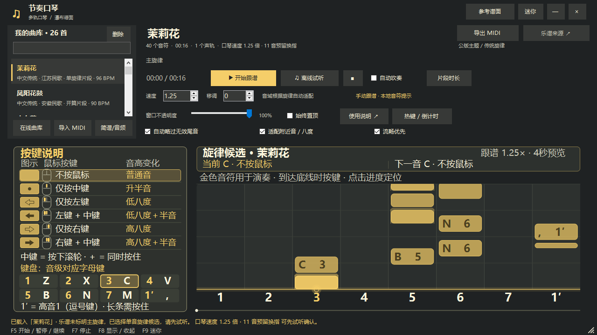

# Rhythm-harmonica · 节奏口琴

面向 Windows 的口琴跟谱与 MIDI 旋律工具，提供瀑布谱、指法提示、离线试听、分段练习和音频转 MIDI。演奏键位面向《三角洲行动 / Delta Force》的口琴操作。

**先选主旋律、试听，再跟着谱面演奏。** 日常使用只需双击 `节奏口琴.exe`，无需打开命令行。

[下载整个项目](https://github.com/xcc6219/Rhythm-harmonica/archive/refs/heads/main.zip) · [使用指南](文档中心/使用指南.html) · [口琴编配说明](文档中心/口琴编配.html)



上图为 1.8.4 原生界面，使用内置《茉莉花》展示实际绘制效果。

## 可以用来做什么

| 用途 | 功能 |
| --- | --- |
| 看谱练习 | 八列瀑布谱显示起音、长音与休止，键盘和鼠标指法同步提示；支持置顶、透明度和迷你窗口。 |
| 练习难段 | 选择片段、放慢到 0.5 倍、循环练习，或指定实际播放总时长。 |
| 整理乐谱 | 批量导入 MIDI、新建文字简谱、管理本地曲库，导出调整后的单旋律 MIDI。 |
| 查找主旋律 | 内置 26 首主题片段，提供 POP909 中文 MIDI 目录、Mutopia 免费谱，以及 QQ／酷狗歌曲搜索入口。 |
| 从录音准备乐谱 | 使用 Basic Pitch 在本机把普通音频转为旋律估计，保存 MIDI，试听后继续修正。 |

多轨文件会显示背景声部，但实际试听和演奏只使用选中的单旋律。软件提供三种使用方式：默认的**手动跟谱**、本机发声的**离线试听**，以及可选的**自动吹奏**。

## 快速开始

1. 点击上方“下载整个项目”，解压到当前用户可写的目录，不要直接在 ZIP 内运行。
2. 双击根目录的 **`节奏口琴.exe`**。
3. 在“我的曲库”选一首内置主题，或点击 **“导入 MIDI”** 选择 `.mid` / `.midi` 文件。
4. 在 **“主旋律”** 下拉框选择声轨。POP909 优先选择 `MELODY`，然后点 **“离线试听”**，确认旋律。
5. 调整速度、移调，或打开 **“片段时长”** 设置练习范围。
6. 点击标题栏 **“参考谱面”**，按 **F5** 开始跟谱。音符底端碰到金色判定线时按键，长条保持到尾端通过；休止时松键。
7. **F7** 停止，**F9** 在迷你与完整界面间切换。

手动跟谱只提供提示，不检测是否按对，也不会自动向游戏发出输入。

### 运行环境

- **Windows 桌面与 .NET Framework 4.8**。完整音频转换使用 64 位 Python 环境，建议使用 64 位 Windows。
- 普通 MIDI 跟谱和试听不需要安装 Python。第一次音频转换时，程序自动联网准备独立识别组件；准备后本机文件可离线转换。
- 音频组件约占 **340 MiB**，实际占用随环境变化；仓库不包含预装的 Python 环境。
- 软件内 QQ 官方登录页需要本机 **Microsoft Edge WebView2 Runtime**。仓库中的 WebView2 SDK 文件不等同于完整运行时。

## 怎么准备自己的曲谱

### 已有 MIDI：直接导入

点击“导入 MIDI”，可一次选择多个文件。优先选择明确标记为 `MELODY`、主旋律或人声的声轨。软件会排除明确的鼓、低音与伴奏角色；没有角色标记时，可能提供一个标为“候选”的单旋律，需要试听确认。

支持标准 MIDI 格式 0 / 1、PPQ 时间格式；暂不支持格式 2、SMPTE，弯音和踏板延音也不会完整还原。内置曲目是主题片段，完整 MIDI 不受这些片段长度限制。

### 在线选谱：优先用现成主旋律

打开“在线曲库”，搜索歌曲并核对歌手、录音版本。存在合适编配时选择 **“选用主旋律 MIDI”**，或明确选择 **“采用此编配 MIDI”**。已有曲目也可以右键 **“查找主旋律谱（保留原谱）”**。

POP909 提供 909 条歌曲目录，MIDI 按需下载；仓库没有预装全部歌曲。钢琴编配与原录音可能在调性、节奏、段落上不同，尤其要区分 Live 和其他歌手版本。

### 只有音频：在本机转为 MIDI

1. 点击 **“简谱/音频” → “歌曲音频 → MIDI”**，选择 MP3、WAV、FLAC 或 OGG。
2. 等待首次组件准备和转换完成，将旋律候选加入曲库。
3. 选用时自动进行口琴编配与可奏检查，先试听短段，再调整移调、速度，或导出编配后的口琴 MIDI。原始转录结果保留，无法编配时会说明原因。

在线歌曲页另有独立的 **“下载录音 → MIDI”** 操作，下载取决于平台实际权限与可用的普通音频地址。已有配对录音可右键 **“重新转录已有音频（保留原谱）”**。

**音频在本机处理，不上传。** 转录得到的是旋律估计，混音中的强伴奏可能被误选，不能保证提取出主唱。清晰单乐器录音或现成主旋律 MIDI 更适合作为起点。受保护的 QMC、MGG、MFLAC、KGM 文件不能靠改扩展名转换。

### 自己写简谱

点击 **“简谱/音频” → “新建文字简谱”**，填写歌名、BPM 和音符，例如：

```text
1 1 5 5 | 6 6 5:2 | 4 4 3 3 | 2 2 1:2
```

空格分隔音符，`|` 分隔小节，`0` 为休止；`1'` 为高八度、`1,` 为低八度、`#4` 为升半音，`5:0.5` 为半拍，`5:2` 为两拍。

## 口琴键位与控制

| 音级 | 1 | 2 | 3 | 4 | 5 | 6 | 7 | 1′ |
| --- | --- | --- | --- | --- | --- | --- | --- | --- |
| 键盘 | Z | X | C | V | B | N | M | , |

鼠标左键降低一个八度，右键提高一个八度，中键升半音；中键可与左键或右键组合。**中键是按下滚轮，不是滚动滚轮。** 长音期间按住所需键盘与鼠标组合，具体以谱面提示为准。逗号键本身对应高音 1。

| 默认热键 | 操作 |
| --- | --- |
| F5 | 开始 / 暂停 / 继续 |
| F7 | 停止 |
| F8 | 收起 / 恢复窗口 |
| F9 | 迷你 / 完整界面 |

在“热键 / 倒计时”中可修改控制热键；占用时可能换为空闲键，以界面底栏实际显示为准。关闭主窗口会退出程序，F8 用于临时收起。

### 让曲谱适合口琴

- 普通歌曲的钢琴和弦、低音与副旋律不会全部交给口琴，先选择明确的主旋律，再编成单声部。三份实谱的对比与具体规则见 [普通歌曲与口琴谱](文档中心/口琴编配.html)。
- 先选对主旋律，再调音域；移调不能把错误的伴奏变成正确旋律。
- 默认开启 **“流畅优先”**：仅在换指困难时省略短小、较弱的邻音装饰候选，显示简化数量；保留主旋律走向、真实休止和同音节奏。关闭可保留装饰音，必要时通过降速完成演奏。
- “适配附近音／八度”优先对整曲采用同一个八度，保留旋律音程；仅对音域边缘做有限的邻音适配，仍不可奏的音按休止处理。
- 手动设置非零移调时，不会再被整曲自动移调抵消。适配可以关闭，原 MIDI 与录音保持不变。
- 使用“片段时长”从难段开始练习。请求速度范围为 0.5–1.5 倍，移调范围为 −24～+24 半音。谱面过密时整曲同比降速，实际倍率在谱面右上角显示，保留你的请求速度设置；最慢速度仍无法满足要求时会明确提示。
- “导出 MIDI”保存当前单旋律计划，包含速度、移调、片段、循环及已启用的音域处理；不是全部伴奏轨的原样导出。
- 瀑布、试听、导出与自动演奏共用口琴编配：跳过不可奏音并保留休止，在必要的音尾预留重复发音和换指间隔，避免只有自动演奏临时改变音长。原曲仍保留，可重新选择声轨、速度与移调。
- 导出 MIDI 明确指定标准 GM 口琴音色。实际声音由外部播放器的音源决定，音色编号本身不代表已正确识别人声旋律。

### 可选自动吹奏

先停止离线试听，勾选“自动吹奏”，按开始键后在倒计时内切回已装备口琴的目标游戏窗口。开始后保持原窗口在前台；切出会停止并释放输入。自动会话期间谱面鼠标穿透，需要修改设置时先按 F7 停止。

自动模式使用系统模拟键鼠。项目未获游戏官方认证，真实游戏音色、键位与输入效果尚未验证；使用前请确认适用规则，不能承诺免处罚。详见 [使用说明与项目边界](文档中心/开源参考.html)。

## 从源码构建

核心界面使用 **C# 5 + WinForms + .NET Framework 4.8**，构建脚本直接调用系统的 `csc.exe`。在项目根目录打开 PowerShell：

```powershell
powershell -NoProfile -ExecutionPolicy Bypass -File ".\程序文件\build.ps1"
```

输出为根目录 `节奏口琴.exe`。构建需要保留 `文档中心/`、曲库元数据和 `程序文件/runtime/webview2/`，这些资源会嵌入启动程序。

运行不依赖真实前台窗口的整合检查：

```powershell
powershell -NoProfile -ExecutionPolicy Bypass -File ".\程序文件\scripts\run-checks.ps1" -WithoutForeground
```

此模式排除原生前台热键和鼠标穿透检查，不能代替真实交互验证。脚本另提供 `-PackagingOnly`、`-SongFlowOnly`、`-WaterfallOnly` 等专项选项，详见脚本参数。Python 转录算法的合成测试位于 `程序文件/tests/test_melody_transcription.py`。

## 项目结构

```text
Rhythm-harmonica/
├── README.md                 项目入口
├── 节奏口琴.exe              Windows 启动程序
├── 程序文件/
│   ├── src/                  C# 源码、图标和 manifest
│   ├── tests/                C# 与 Python 测试
│   ├── scripts/              音频转录、组件准备与检查脚本
│   ├── data/catalog/         POP909 元数据与许可
│   ├── runtime/webview2/     内置网页登录所需 SDK
│   └── build.ps1             构建入口
└── 文档中心/                 离线 HTML 帮助与验证记录
```

运行后，个人歌曲放在 `程序文件/曲目/`，曲库与设置放在 `程序文件/data/`，独立音频环境放在 `程序文件/runtime/python/`。这些个人文件、QQ 登录资料和缓存不随本仓库发布。

## 详细文档与依赖

下载后双击 [`文档中心/main.html`](文档中心/main.html) 阅读完整帮助，无需启动服务器。GitHub 会显示 HTML 源文件，离线浏览请在本地用浏览器打开。

- [使用指南](文档中心/使用指南.html)：导入、跟谱、指法、片段与曲库管理。
- [在线曲库](文档中心/在线曲库.html)：选谱、平台歌曲与音频转换流程。
- [演奏体验优化](文档中心/演奏体验优化.html)：本轮改动和实际验证范围。
- [普通歌曲与口琴谱](文档中心/口琴编配.html)：真实多轨谱对比、单声部、音域和换指编配规则。
- [开源参考](文档中心/开源参考.html)：来源、第三方依赖与使用边界。

音频转换使用 Spotify Basic Pitch 与 ONNX Runtime，网页登录使用 Microsoft WebView2；各组件遵循各自许可。仓库保留 [POP909 许可](程序文件/data/catalog/POP909-LICENSE) 和 [WebView2 许可](程序文件/runtime/webview2/LICENSE.txt)。歌曲、编配和录音的使用须遵循对应来源的授权，第三方组件许可不代表歌曲版权授权。
